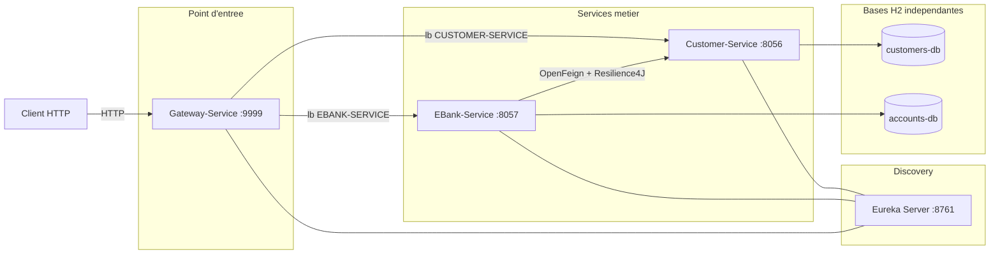

# Diagramme — Architecture générale

## Lecture

- Le client passe en principe par la Gateway.
- Eureka connaît les instances UP.
- EBank appelle Customer via Feign protégé par le Circuit Breaker `customerService`.
- Deux H2 mémoire distinctes : pas de jointure SQL interservices.
