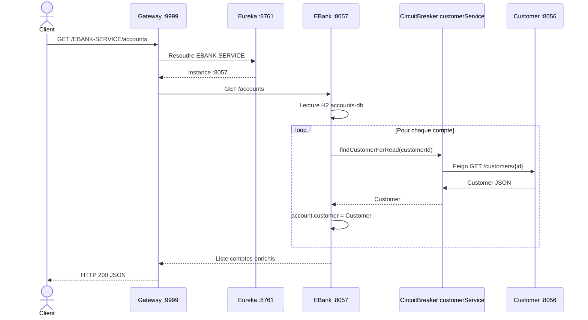

# Diagramme — Consultation des comptes enrichis

## Points clés

- Enrichissement **à la lecture**, pas en base.
- Le champ `customer` est `@Transient`.
- Même flux en appel direct `GET http://localhost:8057/accounts` (sans Gateway).
