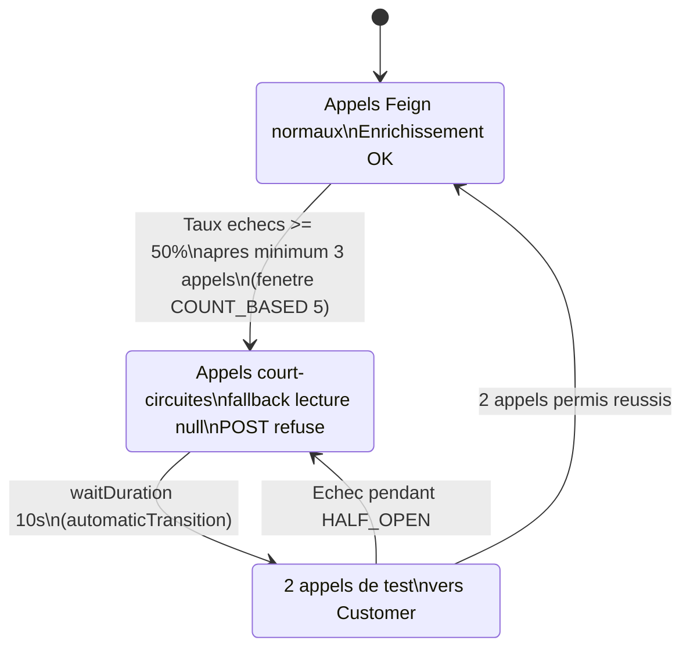

# Diagramme — États du Circuit Breaker

Instance : `customerService`

## Preuves Phase 6 / 7 (Actuator)

| État | Observation typique |
|------|---------------------|
| CLOSED | `failureRate=0%` en fonctionnement normal |
| OPEN | `notPermittedCalls` > 0, lectures via fallback |
| HALF_OPEN | Après ~10 s d’attente OPEN |
| CLOSED | Après 2 succès en HALF_OPEN |

Consulter : `GET http://localhost:8057/actuator/circuitbreakers`
