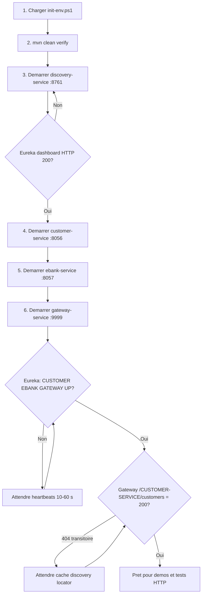

# Diagramme — Déploiement local (ordre de démarrage)

## Remarques

- Ne pas démarrer EBank avant Eureka si l’on veut une découverte immédiate (EBank tolère un démarrage parallèle mais Feign nécessite Customer UP pour l’enrichissement).
- Un premier `404` Gateway juste après l’enregistrement Eureka a été observé en Phase 7 : patienter puis retester.
- Arrêt : stopper uniquement les processus Java démarrés pour la démo ; vérifier ports 8056, 8057, 8761, 9999 libres.
